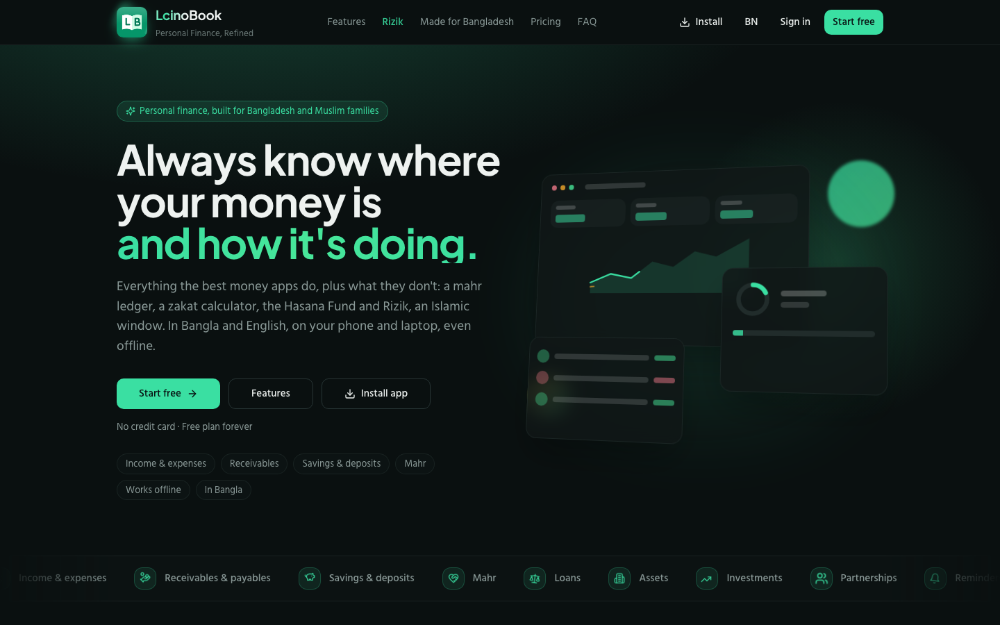
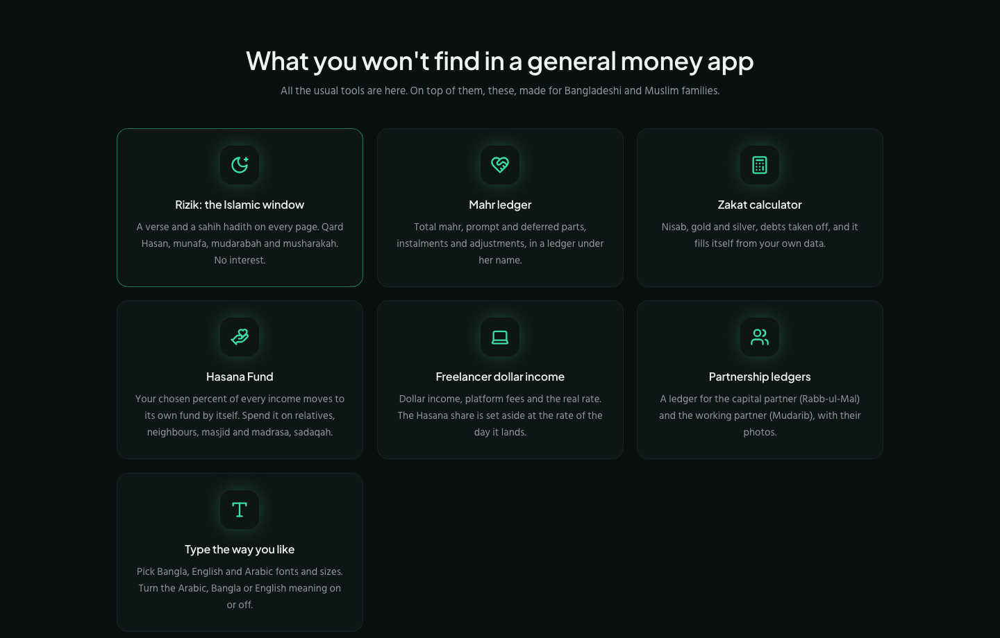
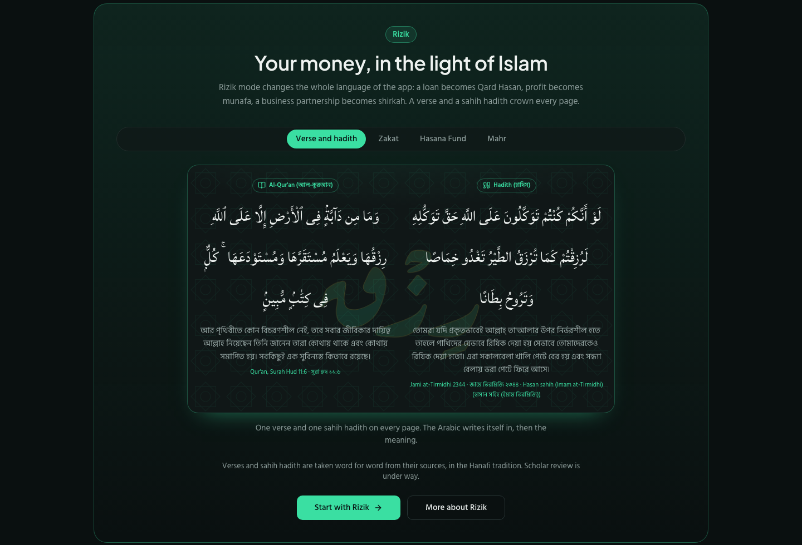
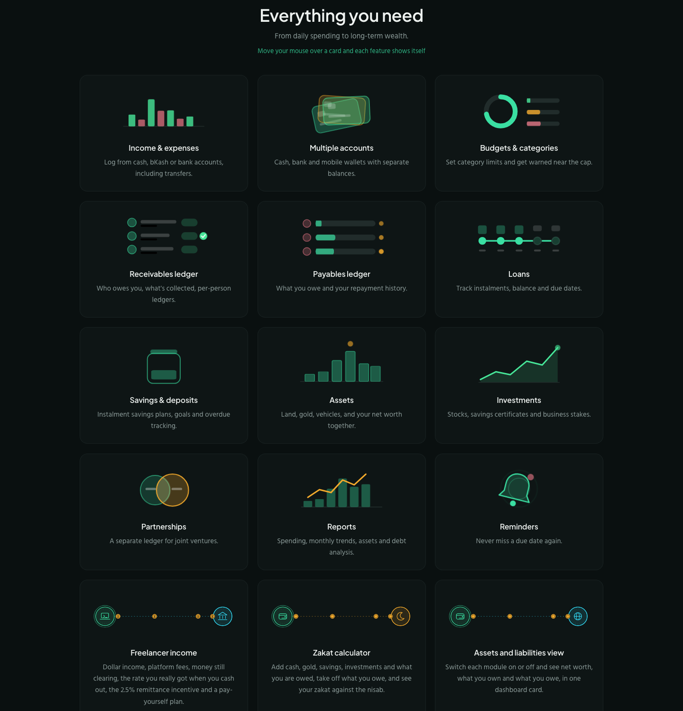
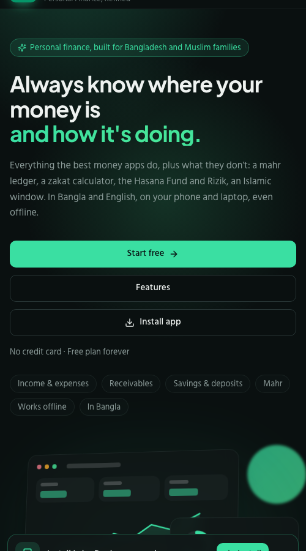

# LcinoBook, a showcase

**Personal finance, refined.** A Bangla-first money app for Bangladesh and Muslim families, built by [LCINO](https://lcino.com).
It tracks income and expenses, receivables and payables, savings, loans, assets and investments, and adds what general money apps
do not have: a **mahr ledger**, a **zakat calculator**, the **Hasana Fund** and **Rizik**, an Islamic mode that changes the whole
language of the app. Bangla and English, on phone and laptop, installable, works offline.

**Try it live:** https://book.lcino.com  ·  **Rizik:** https://book.lcino.com/rizik  ·  **Made by:** https://lcino.com

> This page is a short tour of what we build and how. The product's source code is private.
> Want something like this for your business? Get in touch through **[lcino.com](https://lcino.com)**.

---

## A look at it

### The public site
A fast, bilingual landing page with a live offer banner and pricing that the owner edits from an admin panel.

### What general money apps do not have
Mahr ledger, zakat calculator, Hasana Fund, freelancer dollar income, partnership ledgers, and a typography panel for Bangla, English and Arabic fonts.

### Rizik mode: money in the light of Islam
Loans become Qard Hasan, profit becomes munafa, partnerships become shirkah. A Qur'an verse and a sahih hadith crown every page, the Arabic written in from the right, then English, then Bangla.

### Everything you need, each with its own small animation
Income and expenses, budgets, accounts, receivables and payables, loans, savings, assets, investments, reports and reminders.

### On a phone, it feels like an app
Install it from the browser and it opens without an address bar. On phones there is a bottom tab bar with a raised add button, a "More" launcher, bottom-sheet forms, pull to refresh, safe-area padding and home-screen shortcuts.

---

## How it is built

| Area | What we did |
|---|---|
| **App** | React 18 + TypeScript + Vite, Tailwind with semantic CSS-variable themes (light and dark), shadcn/Radix components, react-router |
| **Data** | Supabase: Postgres with row-level security (every user sees only their own data), Auth, Storage, Edge Functions |
| **Offline** | Installable PWA with a service worker, TanStack Query with a persisted cache, mutations queued while offline |
| **Languages** | Bangla and English everywhere; a third **Rizik** mode with its own wording, verses and hadith, and Arabic typography |
| **Phone feel** | Bottom tab bar, add sheet, launcher, bottom-sheet dialogs, pull to refresh, press feedback, safe areas, manifest shortcuts and deep links |
| **Money rules** | Freelancer income is settled at the day's rate; the Hasana share is taken when income lands; mahr and zakat have their own ledgers |
| **Admin** | Approve upgrades, edit the landing banner and prices, edit payment contact details, see plan numbers |
| **Email** | Transactional email through an Edge Function: payment steps to the member, a heads-up to the owner, and "your Pro is on" after approval |
| **Quality** | 500+ automated tests, TypeScript type-checking and a production build checked on every change |

---

## Work with us

LCINO designs and builds products like this one: bilingual, mobile-first, with real business rules and a polished feel.
See more at **[lcino.com](https://lcino.com)**.
